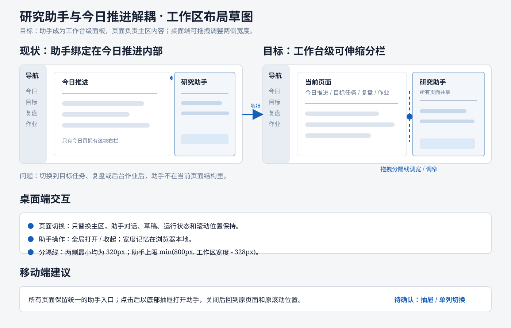

# 研究助手与今日推进解耦：方案草图

版本：草图 0.1  
日期：2026-11-11  
状态：已按确认方案实现，待测试服务器验收

## 1. 我对需求的理解

当前研究助手虽然在应用工作台中保持挂载，但它的布局容器仍然属于“今日推进”页面：

- 助手只和“今日推进”一起显示；切换到目标任务、复盘、后台作业或工牌更新后，助手不可见。
- 顶部的“打开/收起助手”按钮只在今日推进页面出现。
- 今日推进与助手共同占用一个 `research-workspace`，主页面和助手之间没有独立的工作台级分栏控制。
- 当前桌面端的两栏比例由 CSS 固定，用户不能按自己的阅读、编辑或对话需要调整宽度。

本次需求应当把研究助手从“今日推进页面的右栏”提升为“应用工作台的常驻辅助区”：

```text
应用工作台
├── 当前页面区：今日推进 / 目标任务 / 复盘 / 后台作业 / 工牌更新
└── 研究助手区：跨页面持续存在，可打开、收起、调整宽度
```

“解耦”主要指布局和生命周期解耦：助手不再由今日推进页面决定是否存在；页面切换时只替换左侧主内容，右侧助手继续保留当前对话、草稿、运行状态和滚动位置。

## 2. 建议的桌面端结构



桌面端建议把 `app-main` 变成一个工作区容器：

```text
┌──────────────┬──────────────────────────────────┬──────────────────────┐
│ 工作台导航   │ 当前页面区                         │ 研究助手区             │
│              │                                    │                      │
│              │ 今日推进 / 目标任务 / 复盘 / 作业   │ 对话、历史、运行状态   │
│              │                                    │                      │
│              │                                    │                      │
└──────────────┴──────────────────────────────────┴──────────────────────┘
                              ↕ 可拖拽分隔线
```

建议行为：

- 助手默认打开，初始宽度沿用当前约 400px 的视觉基准。
- 拖动主区和助手之间的分隔线，可以连续调整助手宽度。
- 助手设置最小宽度，避免输入框、消息和审批卡片被压缩到不可用；主区也设置最小宽度，避免目标树、甘特图等页面失去基本可读性。
- 收起助手后，当前页面扩展到可用宽度；再次打开时恢复上次宽度。
- 页面切换只更新主区内容，助手不卸载、不清空对话、不重置输入草稿。
- 顶部工具栏的助手入口在所有页面显示，入口文案随状态变化为“收起助手”或“打开助手”。
- 分隔线需要支持键盘操作：聚焦后使用左右方向键调整宽度，Home/End 可跳到最小/最大宽度；鼠标和触摸拖动作为主要操作。

### 宽度状态建议

先采用浏览器本地保存，不增加后端字段：

```text
fasttask.research-assistant.open = true | false
fasttask.research-assistant.width = 360..560
```

如果后续需要跨设备同步，再单独评估是否进入用户偏好 API。宽度只影响当前工作台布局，不改变内容密度和助手功能。

## 3. 页面切换后的关系

| 当前页面 | 主区内容 | 研究助手是否可见 | 助手上下文建议 |
| --- | --- | --- | --- |
| 今日推进 | 今日安排、专注、证据 | 是 | 可继续讨论今日行动 |
| 目标任务 | 目标列表、任务树、甘特图 | 是 | 可继续讨论目标和任务拆解 |
| 复盘 | 复盘记录和筛选 | 是 | 可继续讨论复盘发现 |
| 后台作业 | 作业队列和运行状态 | 是 | 可询问任务执行情况 |
| 工牌更新 | 设备连接和同步 | 是 | 可继续保留研究对话；是否显示设备上下文待确认 |

页面切换本身不应自动发送消息，也不应把助手强行切换到某个新会话。由目标任务页的“和助手聊聊”等入口触发时，可以打开助手并把目标信息作为本次请求的上下文。

## 4. 移动端草图

移动端宽度不足以同时展示两个可用工作区，建议继续使用单列布局，但把助手从“今日推进专属页签”提升为全局入口：

```text
方案 A：全局底部抽屉（推荐）

┌──────────────────────┐
│ 当前页面        对话 │  ← 顶部栏按钮
│                      │
│ 目标任务 / 复盘 / 作业│
│                      │
├──────────────────────┤
│ 研究助手              │  ← 点击后从底部打开，可拖动高度
│ 对话内容              │
│ 输入框                │
└──────────────────────┘
```

方案 A 的好处是所有页面都有一致入口，并且不会因为切换页面而离开当前页面上下文。助手打开后覆盖主内容，关闭后返回原页面和原滚动位置。

当前代码已有“今日任务 / 对话”单列切换，也可以作为实现过渡；但如果继续使用只存在于今日页内部的页签，容易再次把助手和今日推进绑定在一起，因此建议最终统一为工作台级抽屉或全局单列切换。

## 5. 组件边界建议

当前结构大致是：

```text
Workspace
└── app-main
    ├── ResearchWorkspace（今日推进 + 助手）
    ├── FastPanel
    └── 其他页面
```

建议调整为：

```text
Workspace
└── app-main
    └── ResearchWorkbenchLayout
        ├── PageViewport
        │   ├── Today
        │   ├── GoalManager
        │   ├── Review
        │   ├── JobQueue
        │   └── FastPanel
        └── ResearchAssistantPane
            └── AgentChat
```

其中：

- `ResearchWorkbenchLayout` 负责主区/助手区的分栏、开关、拖拽宽度和响应式布局。
- `PageViewport` 负责根据当前 Tab 显示业务页面，不负责助手的显示状态。
- `ResearchAssistantPane` 负责助手标题、对话容器和 `AgentChat`，在页面切换时保持同一个挂载点。
- `Today` 里的“和助手聊聊”仍然保留，但它只调用一个全局的打开助手动作，不再直接切换自己的内部页面布局。
- `GoalManager` 传入的目标聊天请求继续保留，用于打开助手后携带目标上下文。

## 6. 这版草图中暂定的产品行为

### 已按需求推导的部分

1. 助手在所有工作台页面可见。
2. 助手和主页面可以调整宽度。
3. 页面切换不影响助手对话和运行状态。
4. 助手可以收起，主页面获得剩余空间。
5. 助手入口从今日页专属入口提升为全局入口。

### 需要对齐的部分

1. “所有页面”是否包含工牌更新，以及移动端页面？本草图按包含处理。
2. 桌面端助手是否默认打开？本草图沿用当前默认打开。
3. 移动端采用底部抽屉，还是保留“当前页面 / 对话”两页切换？本草图推荐底部抽屉。
4. 助手宽度是否需要记忆？本草图建议记忆，并按设备保存浏览器本地偏好。
5. 切换到不同业务页面时，助手标题和上下文是否保持“研究助手”，还是显示当前页面上下文提示？本草图建议标题保持稳定，必要时在消息上下文中提示来源。
6. 工牌更新页面是否允许助手对设备操作提供上下文或操作入口？本草图只保留助手，不新增设备操作权限。

## 7. 后续实现范围（对齐后再开始）

- 从 `ResearchWorkspace` 中拆出全局助手面板和今日推进页面。
- 把当前页面渲染统一纳入可伸缩的工作区布局。
- 增加拖拽分隔线、键盘调整、最小/最大宽度和本地宽度记忆。
- 保持 `AgentChat` 单实例挂载，验证页面切换、流式响应、草稿、审批和滚动位置。
- 更新桌面端、平板端和移动端布局；移动端按确认的方案实现。
- 增加 1440px、1024px、390px 的验收场景，并覆盖全部页面入口。

## 8. 验收示例

1. 在今日推进输入一段对话，切换到目标任务，助手仍显示同一段对话。
2. 在目标任务页拖宽助手，再切换到复盘，助手宽度保持不变。
3. 收起助手后进入后台作业，再打开助手，原来的对话、草稿和运行状态仍在。
4. 刷新页面后，助手开关状态和宽度按本地偏好恢复；Agent 会话按现有恢复机制恢复。
5. 在移动端的目标任务、复盘和后台作业页均能打开助手，关闭后回到原页面。
6. 分隔线可用鼠标、触摸和键盘操作，主区和助手区都不会出现横向溢出。

## 9. 相关现状入口

- [应用外壳与 Tab 导航](../web/src/App.tsx)
- [当前今日推进与助手组合](../web/src/ResearchWorkspace.tsx)
- [今日推进页面](../web/src/Today.tsx)
- [Agent 对话入口](../web/src/agent/index.tsx)
- [通用布局样式](../web/src/styles.css)
- [工作台主题样式](../web/src/workbench-theme.css)

## 10. 实现记录

已完成：

- 研究助手从今日推进组件中拆出，提升为工作台级常驻面板。
- 今日推进、目标任务、复盘、后台作业和工牌更新共用同一助手面板。
- 桌面端支持鼠标、触摸和键盘调整助手宽度，范围为 320–560px。
- 助手开关和宽度保存到浏览器本地偏好。
- 1024px 使用导航 Rail 入口，390px 使用顶部入口；两种移动布局均以底部抽屉显示助手。
- 更新浏览器回归，覆盖跨页面助手入口、收起/打开、草稿保留和响应式布局。

验证结果：

```text
前端测试：74/74 通过
生产构建：通过
Chromium 回归：通过
尺寸：1440px、1024px、390px
```

