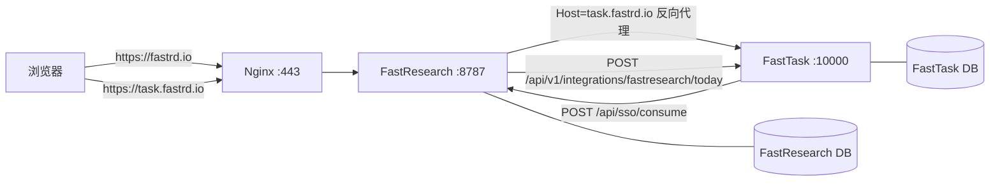
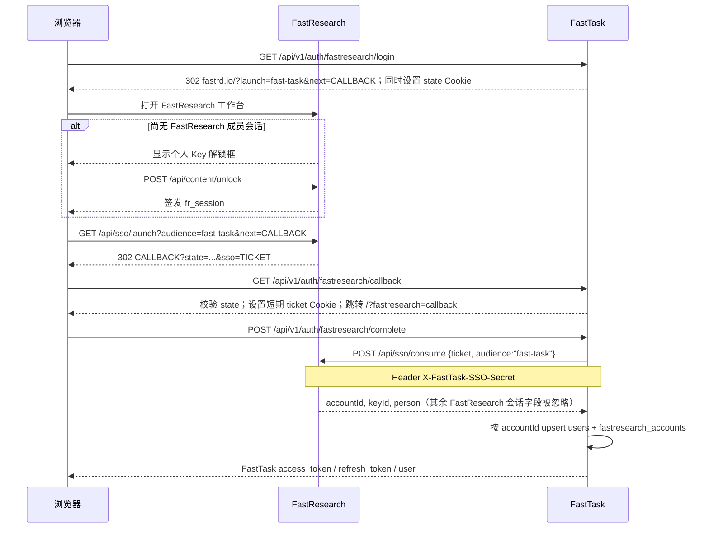
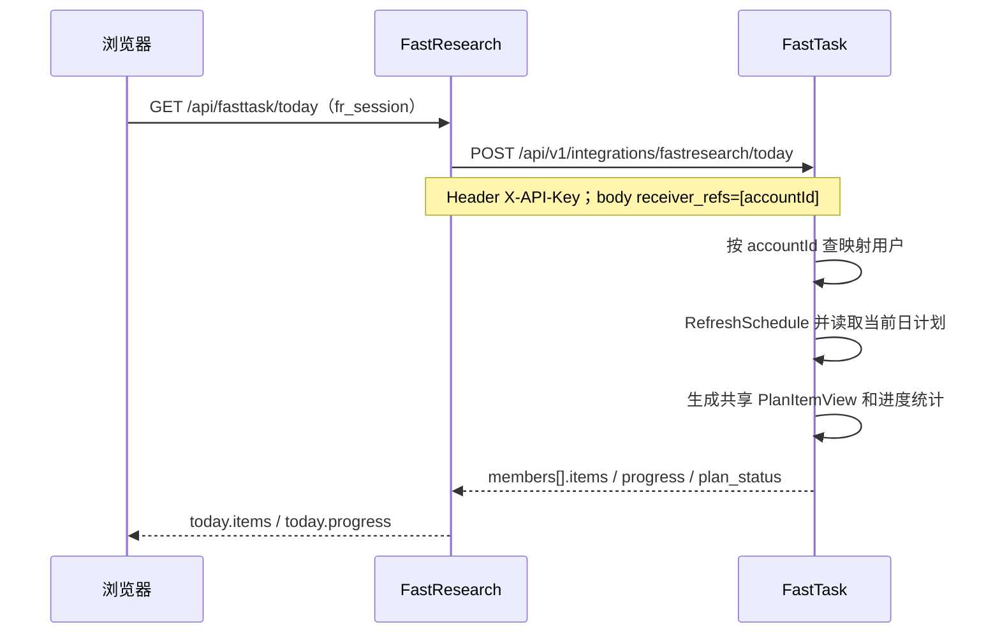
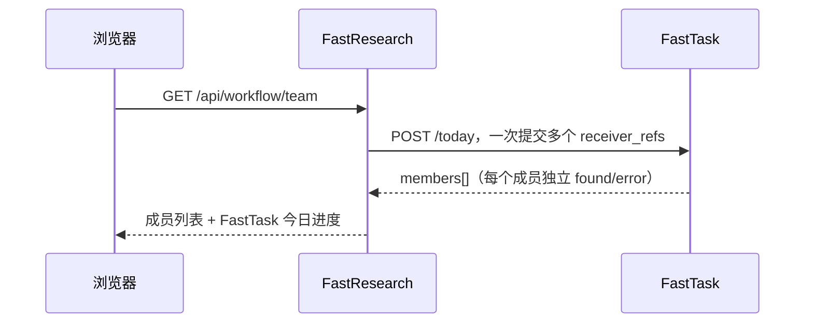

# FastTask 与 FastResearch 集成架构

> 适用范围：FastTask `xiatong` 分支与 FastResearch `main` 分支的当前实现。
>
> 最后核对：2026-10-24。
>
> 本文只记录两端代码中已经存在的行为；预留或历史协议单独标出，不视为当前可用能力。

## 1. 结论摘要

FastTask 与 FastResearch 是两套独立部署、独立数据库的服务。当前连接分为三条主链路：

1. **身份链路**：用户在 FastResearch 使用个人 Key 登录，再通过一次性 SSO 票据进入 FastTask。FastTask 用 `accountId` 创建或复用本地用户，原始个人 Key 不进入 FastTask。
2. **今日任务读取链路**：FastResearch 服务端使用共享 API Key 调用 FastTask 的批量只读接口，按 FastResearch `accountId` 获取对应用户的今日计划和任务进度。
3. **公网入口链路**：当前部署中，`fastrd.io` 和 `task.fastrd.io` 都由 Nginx 接入；FastResearch 还会按 Host 将 `task.fastrd.io` 反向代理到本机 FastTask。

当前**没有**实现 FastResearch 向 FastTask 写入完成状态，也**没有**在 FastTask 中实现任务下发、账户生命周期和进度回传接口。FastTask 的今日计划、任务状态和完成记录仍以 FastTask 为唯一事实源。

## 2. 服务与数据职责

| 能力 | FastResearch | FastTask |
| --- | --- | --- |
| 个人 Key 管理 | 生成、校验、撤销 `fk_...` Key | 不保存、不接收个人 Key |
| 用户身份主键 | `accountId` | `fastresearch_accounts.account_id` |
| 用户资料 | `person`、`keyId` | `users.display_name`、映射表中的 `key_id`/`person` |
| 登录态 | `fr_session`，默认 2 天 | 自己的 access/refresh token |
| 今日计划与任务 | 只读展示 FastTask 数据 | 唯一业务事实源 |
| 今日计划状态 | 不写回 | 生成、刷新、推进、撤销 |
| 数据库 | `accounts.sqlite`、`workflows.sqlite` 等 | FastTask SQLite |

两端不共享数据库，也不直接读取对方的数据文件。跨服务通信只通过 HTTPS/HTTP API 完成。

## 3. 当前部署拓扑



当前生产配置中：

| 组件 | 公网地址 | 内网地址 |
| --- | --- | --- |
| FastResearch | `https://fastrd.io` | `http://127.0.0.1:8787` |
| FastTask | `https://task.fastrd.io` | `http://127.0.0.1:10000` |

FastResearch 的 `server/fasttask-proxy.mjs` 会识别 `FASTTASK_PROXY_HOST`（默认 `task.fastrd.io`），把请求透明转发到 `FASTTASK_PROXY_URL`（默认 `http://127.0.0.1:10000`）。因此公网 FastTask 页面和 API 可以继续使用 `task.fastrd.io`，而 FastTask 进程本身只监听回环地址。

部署时也可以让 Nginx 直接把 `task.fastrd.io` 转发给 FastTask，此时 FastResearch 代理不是必需组件；但两端配置的公开地址必须与浏览器实际访问的 Origin 一致。

## 4. 身份登录链路

### 4.1 参与凭证

| 凭证 | 产生方 | 保存方 | 有效期 | 用途 |
| --- | --- | --- | --- | --- |
| FastResearch 个人 Key `fk_...` | FastResearch 管理员 | 用户输入；FastResearch 只存哈希 | 可配置 | FastResearch 用户解锁 |
| FastResearch 会话 `fr_session` | FastResearch | 浏览器 HttpOnly Cookie / 成员请求 | 默认 2 天 | 发起 FastTask SSO |
| SSO 票据 `ticket` | FastResearch | FastResearch 服务端短期存储 | 2 分钟，一次性 | FastTask 兑换身份 |
| SSO 共享密钥 | 运维配置两端 | 两端环境变量 | 长期 | 证明兑换方是 FastTask 服务端 |
| FastTask access token | FastTask | FastTask 前端 | 默认 1 小时 | 调用 FastTask 用户 API |
| FastTask refresh token | FastTask | FastTask 前端安全存储 | 默认 30 天 | 刷新 FastTask access token |

FastTask 接收的是 `accountId`、`keyId`、`person` 等服务端身份字段，**不接收个人 Key，也不接受浏览器直接提交的 Key**。

### 4.2 时序



### 4.3 FastTask 登录入口

| 方法 | 路径 | 认证 | 行为 |
| --- | --- | --- | --- |
| `GET` | `/api/v1/auth/fastresearch/available` | 无 | 返回是否启用及 FastResearch 公开地址 |
| `GET` | `/api/v1/auth/fastresearch/login` | 无 | 生成 32 字节随机 `state`，设置 HttpOnly Cookie，跳转 FastResearch |
| `GET` | `/api/v1/auth/fastresearch/callback` | 无 | 校验 `state`，接收一次性 `sso` 票据，暂存到短期 Cookie |
| `POST` | `/api/v1/auth/fastresearch/complete` | 同源请求 | 读取票据 Cookie，服务端向 FastResearch 兑换身份 |

FastTask 的 `state` Cookie：

- 名称：`fasttask.fastresearch.state`
- 路径：`/api/v1/auth/fastresearch`
- `HttpOnly`、`SameSite=Lax`
- `FASTTASK_PUBLIC_URL` 为 HTTPS 时带 `Secure`
- 有效期 5 分钟
- `complete` 还要求 `Origin` 精确等于 `FASTTASK_PUBLIC_URL`

票据 Cookie 使用 Base64URL 暂存，不写入 localStorage；`complete` 读取后立即删除。

### 4.4 FastResearch 票据兑换

FastTask 服务端调用：

```http
POST {FASTTASK_FASTRESEARCH_URL}/api/sso/consume
Content-Type: application/json
X-FastTask-SSO-Secret: <共享密钥>

{"ticket":"<一次性票据>","audience":"fast-task"}
```

FastResearch 按顺序验证：

1. `audience` 必须为 `fast-task`。
2. `X-FastTask-SSO-Secret` 必须与 `FASTRESEARCH_FASTTASK_SSO_SECRET` 完全一致，且使用常量时间比较。
3. 票据未过期、未使用、audience 一致。
4. 票据关联的个人 Key 仍然有效，且凭证版本未变化。
5. 返回稳定的 `accountId`、当前 `keyId` 和显示名 `person`。

FastTask 成功兑换后在一个数据库事务中完成：

- 首次登录：创建 `users` 用户，`identifier=fastresearch:<accountId>`，角色 `member`，状态 `active`。
- 创建 `fastresearch_accounts` 映射，`account_id` 为稳定主键，`user_id` 唯一。
- 后续登录：复用映射到的本地用户，更新 `key_id`、`person` 和 `display_name`。
- 创建 `auth_source=fastresearch` 的 FastTask 会话并签发本地 token。

### 4.5 身份边界

- FastResearch 的 `accountId` 是跨系统稳定主键；姓名只用于显示，不能用于关联账户。
- FastResearch Key 轮换后 `accountId` 不变，`keyId` 会变化。
- FastResearch 的 `fr_session` 只用于 FastResearch 自身；FastTask 兑换身份后签发自己的 token，不复用该会话。
- FastTask 成员不使用本地密码登录。启用 FastResearch 登录后，非管理员密码登录会被拒绝；本地账号密码仅保留给管理员。
- 同一个 FastResearch 账户只能映射到一个 FastTask 用户。
- FastTask 不知道个人 Key 明文，FastResearch 也不需要保存 FastTask 用户密码。

## 5. 今日任务读取链路

### 5.1 数据流向



FastResearch 的团队视图会批量请求所有有效成员的 `accountId`：



FastResearch 服务端对 `today` 结果做 8 秒短缓存，用于合并同时发生的个人今日读取和团队进度读取；成员页面通常每 15 秒轮询一次。

### 5.2 FastTask 入站接口

```http
POST /api/v1/integrations/fastresearch/today
Content-Type: application/json
X-API-Key: <FASTTASK_FASTRESEARCH_INGEST_KEY>

{"receiver_refs":["account_...","account_..."]}
```

规则：

- 认证头支持 `X-API-Key`；兼容旧调用方的 `X-FastResearch-Provision-Key`。
- `receiver_refs` 必填；空白值去重后最多处理 200 个。
- 返回按请求顺序排列的 `members`；单个账户不存在时只把该成员的 `found` 置为 `false`，不会让整个批次失败。
- 响应设置 `Cache-Control: no-store`，请求体上限 256 KiB。
- 读取会调用 `RefreshSchedule`，因此 FastTask 中刚新增或调整的任务会在下一次读取时反映到今日计划。

成功响应结构：

```json
{
  "members": [
    {
      "receiver_ref": "account_...",
      "found": true,
      "user_id": "user_...",
      "display_name": "成员姓名",
      "local_date": "2026-10-24",
      "timezone": "Asia/Shanghai",
      "plan_id": "plan_...",
      "plan_status": "active",
      "plan_revision": 3,
      "updated_at": "2026-10-24T13:00:00+08:00",
      "items": [
        {
          "id": "item_...",
          "task_id": "task_...",
          "kind": "core",
          "title": "今日任务",
          "commitment": "完成一个可核对的小步骤",
          "minimum_action": "先做最小的一步",
          "status": "planned",
          "completion_type": "",
          "completion_summary": "",
          "target_minutes": 30,
          "position": 1,
          "workspace": {
            "system": "fastwrite",
            "label": "打开 FastWrite",
            "url": "https://fastrd.io/Write/"
          }
        }
      ],
      "progress": {
        "total": 1,
        "completed": 0,
        "in_progress": 0,
        "planned": 1,
        "skipped": 0
      }
    }
  ]
}
```

### 5.3 字段映射

| FastTask 字段 | FastResearch 展示字段 | 说明 |
| --- | --- | --- |
| `receiver_ref` | `today.accountId` 的内部索引 | FastResearch 用它把结果映射回成员 |
| `found` | `received` 的判定前提 | `false` 表示未找到账户映射或用户不可用 |
| `local_date` / `timezone` | `today.date` / `today.timezone` | 以 FastTask 计划时区为准 |
| `plan_status` / `plan_revision` | `today.planStatus` / `today.planRevision` | FastTask 当前日计划 |
| `items[].status=satisfied` | `progress.completed` | 已完成 |
| `items[].status=in_progress` | `progress.inProgress` | 进行中 |
| `items[].status=skipped` | `progress.skipped` | 已跳过 |
| 其他状态 | `progress.planned` | 计划中 |
| `items[].workspace` | 工作台入口 | FastTask 生成，不要求 FastResearch 推断外部系统状态 |

### 5.4 FastResearch 对外接口

| 方法 | 路径 | 认证 | 说明 |
| --- | --- | --- | --- |
| `GET` | `/api/fasttask/today` | `fr_session` | 当前成员今日任务；服务端强制刷新缓存 |
| `GET` | `/api/workflow/team` | `fr_session` | 团队成员与批量今日进度 |

FastResearch 在这两个接口中只使用当前成员会话解析 `accountId`，浏览器不能指定其他账户的 `receiver_ref`。

## 6. 配置对应关系

### 6.1 FastTask 侧

| 变量 | 示例 | 说明 |
| --- | --- | --- |
| `FASTTASK_PUBLIC_URL` | `https://task.fastrd.io` | 浏览器访问 FastTask 的公开 Origin，用于回调与同源校验 |
| `FASTTASK_FASTRESEARCH_LOGIN_ENABLED` | `true` | 启用 FastResearch Key 登录 |
| `FASTTASK_FASTRESEARCH_URL` | `http://127.0.0.1:8787` | FastTask 服务端访问 FastResearch 的地址 |
| `FASTTASK_FASTRESEARCH_PUBLIC_URL` | `https://fastrd.io` | 浏览器访问 FastResearch 的公开地址 |
| `FASTTASK_FASTRESEARCH_SSO_SECRET` | 随机值，至少 32 字符 | 必须与 FastResearch 的 `FASTRESEARCH_FASTTASK_SSO_SECRET` 相同 |
| `FASTTASK_FASTRESEARCH_INGEST_KEY` | 随机值 | 必须与 FastResearch 的 `FASTTASK_API_KEY` 相同 |
| `FASTTASK_FASTRESEARCH_LOOPBACK_HTTP` | `false` | 生产环境仅允许回环 HTTP 地址时设为 `true` |

### 6.2 FastResearch 侧

| 变量 | 示例 | 说明 |
| --- | --- | --- |
| `FASTTASK_PUBLIC_URL` | `https://task.fastrd.io` | 浏览器跳转 FastTask 的地址 |
| `FASTTASK_URL` | `http://127.0.0.1:10000` | FastResearch 服务端访问 FastTask 的地址 |
| `FASTTASK_API_KEY` | 随机值 | 必须与 FastTask 的 `FASTTASK_FASTRESEARCH_INGEST_KEY` 相同 |
| `FASTRESEARCH_FASTTASK_SSO_SECRET` | 随机值，至少 32 字符 | 必须与 FastTask 的 `FASTTASK_FASTRESEARCH_SSO_SECRET` 相同 |
| `FASTTASK_PROXY_HOST` | `task.fastrd.io` | FastResearch 代理 FastTask 时识别的 Host |
| `FASTTASK_PROXY_URL` | `http://127.0.0.1:10000` | 代理目标 |

### 6.3 密钥关系

```text
个人 Key fk_...                只在 FastResearch 校验，不下发
FASTTASK_FASTRESEARCH_SSO_SECRET
  == FASTRESEARCH_FASTTASK_SSO_SECRET      用于 /api/sso/consume
FASTTASK_FASTRESEARCH_INGEST_KEY
  == FASTTASK_API_KEY                      用于 /api/v1/integrations/fastresearch/today
```

这些密钥是三组不同职责的凭证，不应复用 FastTask 的 JWT、模型 Provider Key 或 FastResearch 管理员密码。配置示例中只使用占位值，真实密钥不得提交到仓库。

## 7. 旧版或预留协议

FastResearch 代码中仍保留 FastTask 工作流客户端，FastTask `xiatong` 分支当前只实现了 `today` 读取接口。以下路径属于历史设计或预留能力，**不能作为当前上线依据**：

| 能力 | FastResearch 侧路径/方法 | 当前 FastTask 状态 |
| --- | --- | --- |
| FastResearch 接收 Task 下发 | `POST /api/workflow/publish`，`fasttask-dispatch-v1` | 未在 FastTask 中实现发送端 |
| FastResearch 创建 FastTask 任务 | FastResearch `/api/fasttask/tasks` → FastTask `/api/v1/integrations/fastresearch/tasks` | FastTask 未实现 `/tasks` |
| 工序完成回传 | FastResearch `FastTaskClient.publishProgress` → `/api/v1/integrations/fastresearch/progress` | FastTask 未实现 `/progress` |
| 账户生命周期同步 | `/api/v1/integrations/fastresearch/accounts...` | FastTask 未实现账户开通/轮换/删除接口 |
| Panel 摘要 | `GET /api/v1/panel/summary` | FastTask 有通用只读接口，但当前 FastResearch 今日任务链路不走它 |

如果后续启用双向工作流，需要重新定义 FastTask 的写入接口、幂等键、任务与工序的状态机以及失败重试语义；不能直接假设上述客户端已有服务端实现。

## 8. 安全设计

1. **个人 Key 不跨域**：FastResearch 只在服务端校验个人 Key，FastTask 只接收一次性票据兑换出的身份。
2. **票据一次性**：SSO 票据有效期 2 分钟，使用后立即失效；`state` 防止登录请求被拼接或重放。
3. **服务端兑换**：FastTask 浏览器只拿到短期票据 Cookie，兑换由 FastTask 服务端完成，并附带共享密钥。
4. **常量时间比较**：SSO 共享密钥和今日任务 API Key 都使用常量时间比较，降低时序侧信道风险。
5. **同源校验**：`complete` 要求 `Origin` 等于 FastTask 公开地址；Cookie 限定路径、HttpOnly、SameSite=Lax，HTTPS 下加 Secure。
6. **最小数据面**：今日任务接口只返回展示所需的任务、进度和工具入口，不返回个人 Key、FastResearch 会话或其他成员私有内容。
7. **账户隔离**：FastResearch 只按当前 `accountId` 请求个人任务；团队视图由 FastResearch 服务端批量组装，不接受浏览器任意指定成员。
8. **无共享数据库**：两端各自管理数据，避免一个服务的数据库故障直接暴露或修改另一个服务的数据。

## 9. 故障排查

| 现象 | 优先检查 |
| --- | --- |
| FastTask 登录页没有 FastResearch 按钮 | `FASTTASK_FASTRESEARCH_LOGIN_ENABLED`、`/api/v1/auth/fastresearch/available` |
| 登录后回到 FastResearch 又提示登录 | `state` Cookie 是否被代理清除；`FASTTASK_PUBLIC_URL` 是否与浏览器 Origin 一致 |
| `FastResearch login failed` / 401 | 两端 SSO Secret 是否一致；票据是否超过 2 分钟；票据是否已使用；成员 Key 是否仍有效 |
| `same-origin request required` | 反向代理是否改写 Origin；`FASTTASK_PUBLIC_URL` 是否使用正确协议和域名 |
| 今日任务一直为空 | FastResearch 的 `FASTTASK_URL` 是否可达；`FASTTASK_API_KEY` 是否等于 FastTask 的 ingest key；用户是否已通过 FastResearch 登录并建立映射 |
| 返回 `found:false` | 该 `accountId` 尚未登录过 FastTask，或 FastTask 本地用户已停用 |
| FastResearch 显示 FastTask 连接错误 | FastResearch 日志中的 4 秒超时、FastTask `/health/ready`、网络策略和代理配置 |
| `task.fastrd.io` 返回 502 | FastResearch 代理目标 `FASTTASK_PROXY_URL`；FastTask 是否监听对应地址；Nginx 上游 |
| API Key 返回 503 | FastTask 未配置 `FASTTASK_FASTRESEARCH_INGEST_KEY` |
| API Key 返回 401 | 共享 Key 不一致，或请求未带 `X-API-Key` |

### 快速检查

```bash
# 两端健康状态
curl -fsS https://fastrd.io/api/health
curl -fsS https://task.fastrd.io/health/ready

# 今日任务接口；密钥从环境读取，不要写进 shell 历史或仓库
curl -fsS http://127.0.0.1:10000/api/v1/integrations/fastresearch/today \
  -H "Content-Type: application/json" \
  -H "X-API-Key: $FASTTASK_FASTRESEARCH_INGEST_KEY" \
  --data '{"receiver_refs":["account_REPLACE_ME"]}'
```

### 密钥轮换顺序

1. 先生成新密钥，不删除旧值。
2. 同时更新两端环境变量并重启服务，确保新旧请求都不因短暂窗口失败。
3. 验证一次 FastResearch 登录和一次今日任务读取。
4. 确认无旧请求后，再清理旧密钥的运维记录。

SSO Secret 和 Ingest Key 必须分别轮换；不要把个人 Key 当作服务端共享密钥使用。

## 10. 代码索引

### FastTask

| 文件 | 内容 |
| --- | --- |
| [`internal/httpapi/fastresearch.go`](../internal/httpapi/fastresearch.go) | FastResearch 登录入口、票据兑换、今日任务 API |
| [`internal/platform/auth/fastresearch.go`](../internal/platform/auth/fastresearch.go) | 票据服务端兑换、账户映射、FastTask 会话签发 |
| [`internal/config/config.go`](../internal/config/config.go) | FastResearch 配置读取与启动校验 |
| [`internal/httpapi/planview.go`](../internal/httpapi/planview.go) | 当前日计划读取与刷新 |
| [`migrations/000019_fastresearch_accounts.up.sql`](../migrations/000019_fastresearch_accounts.up.sql) | `fastresearch_accounts` 表结构 |
| [`internal/httpapi/server.go`](../internal/httpapi/server.go) | 路由注册与通用认证/CORS |

### FastResearch

| 文件 | 内容 |
| --- | --- |
| `server/index.mjs` | SSO 发起/兑换、`/api/fasttask/today`、团队视图、FastTask 代理路由 |
| `server/fasttask-client.mjs` | 今日任务读取与历史工作流客户端 |
| `server/fasttask-proxy.mjs` | 按 Host 将 `task.fastrd.io` 代理到 FastTask |
| `docs/key-login.md` | 个人 Key 与 SSO 协议说明 |
| `docs/sso.md` | SSO 票据协议 |

## 11. 变更原则

- 修改 `accountId` 映射、回调路径、Cookie 名称或 Header 名称时，必须同步更新两端文档和联调用例。
- 今日任务接口的字段是 FastResearch 展示层的输入；新增字段应保持向后兼容，删除或重命名字段必须版本化。
- 任何写入 FastTask 的新接口都必须使用稳定幂等键，明确账户隔离，并定义重试、冲突和撤销语义。
- 不要把内部隧道地址、共享密钥、个人 Key 或 FastResearch 会话写入浏览器可见 URL、日志或 Git 仓库。
